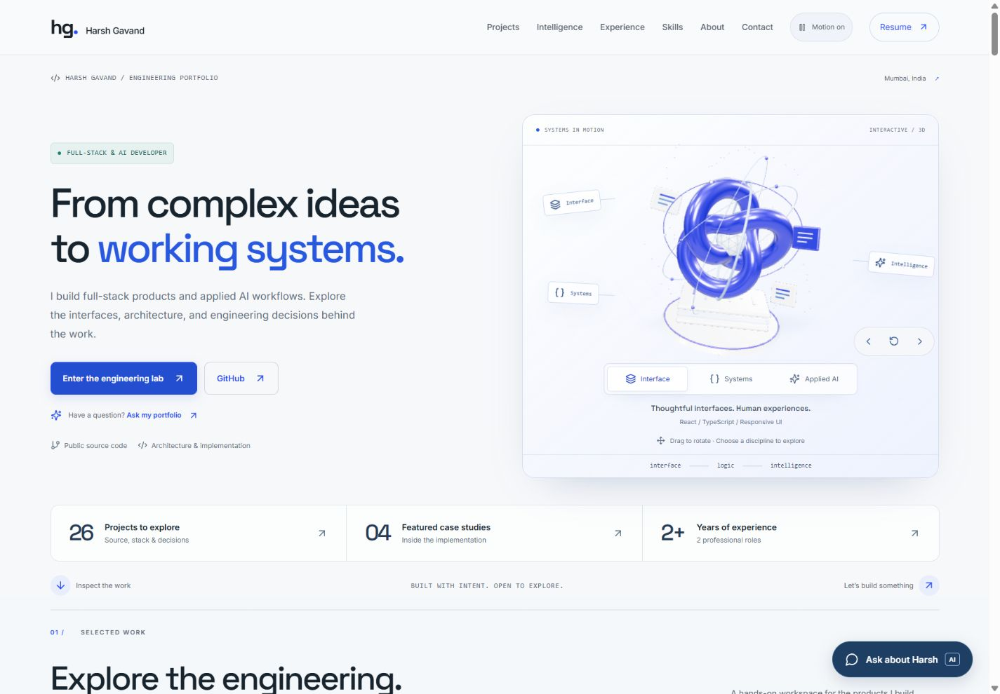
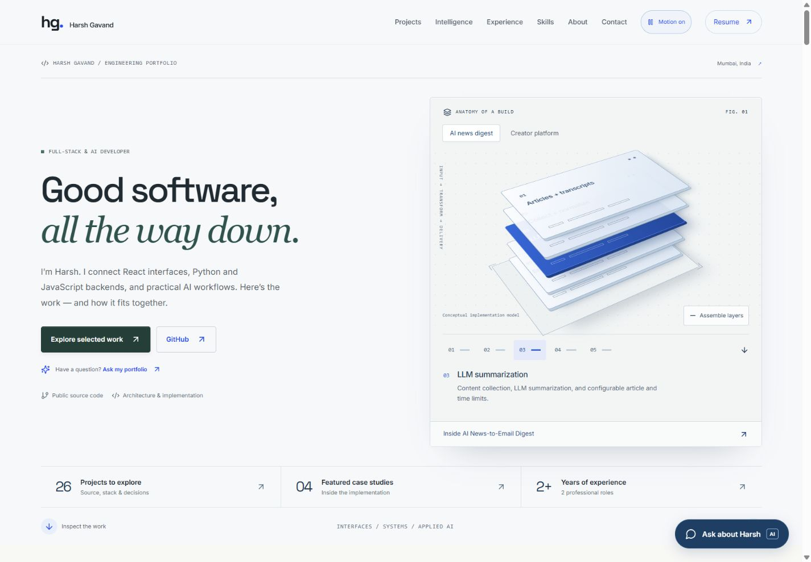
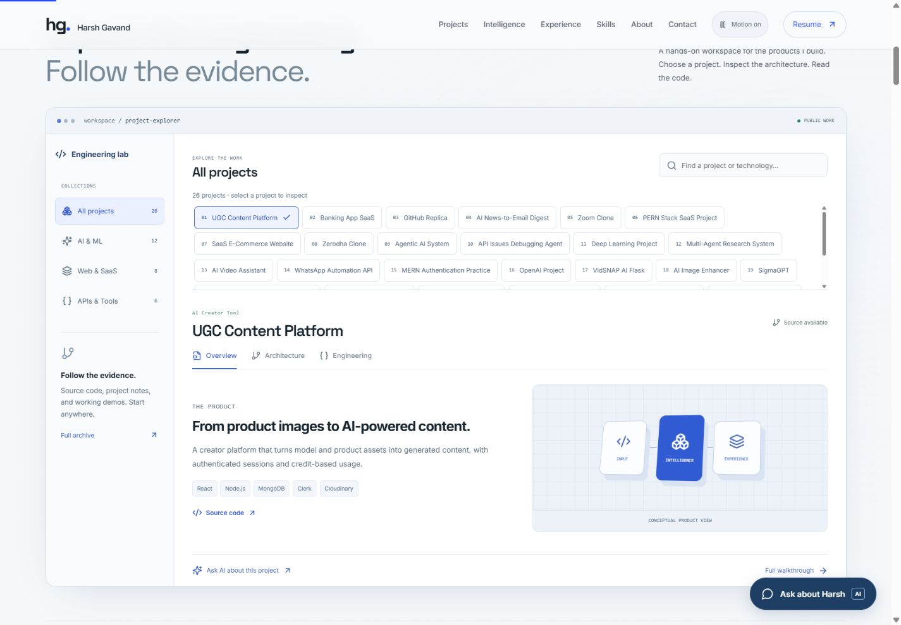
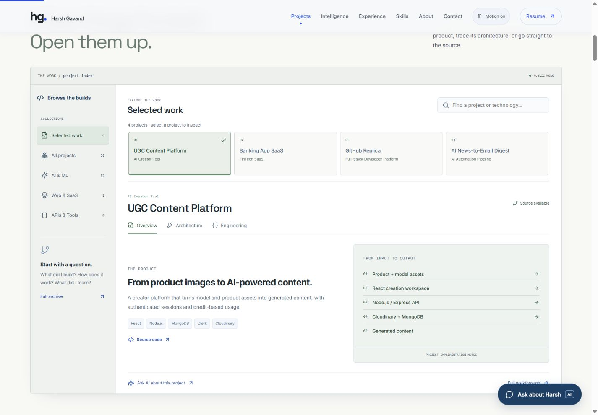
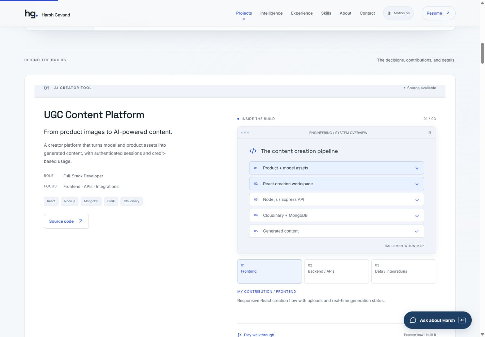
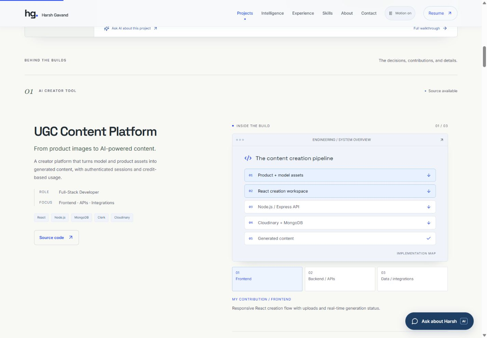
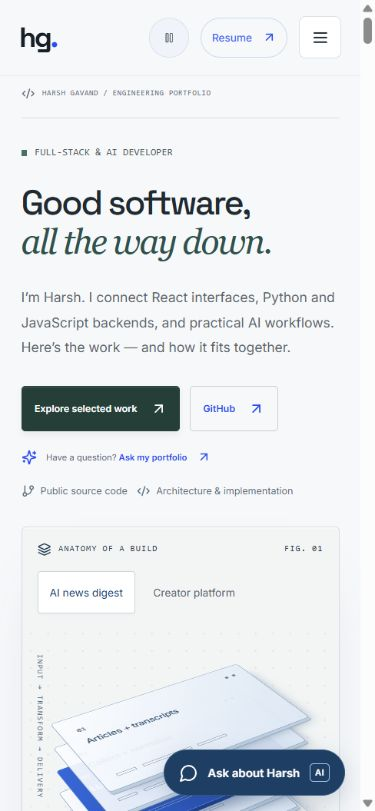
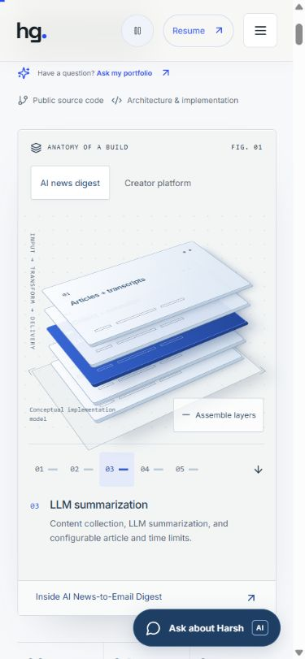

# Portfolio craft refinement — 13 October 2026

## Brief and conclusion

Refine the existing engineering portfolio so the experience feels specific to Harsh's work. Preserve real content, the complete catalog, source/demo links, resume, assistant, and contact behavior. Keep the name compact and prioritize proof of work. The strongest opportunity was to give the existing depth and interaction a concrete subject, then reduce repeated visual framing.

## Captured audit and changes

1. **First impression — clear, but insufficiently specific.** The original hero had a clear CTA and compact identity, but the large abstract torus sculpture explained nothing about a project. Small labels and floating cards made it look like a reusable technology landing page. Replaced it with a physical-looking, manipulable implementation model of the published AI digest and creator-platform diagrams. Two builds, five layers, assembly/separation controls, contribution notes, and direct case-study links turn the focal point into evidence. The warm paper, dark green accent, serif phrase, and fine technical rules distinguish the visual language.

   Before: 
   After: 

2. **Project discovery — functional, but cognitively crowded.** The original dashboard offered 26 small, equal-weight buttons and an internal scroll area before the selected project's explanation. It asked a first-time visitor to curate the work. The default now presents four selected builds, with category context, a quiet selection marker, and restrained hover feedback. All 26 remain available through the existing filters; typing from Selected work searches the full catalog. Generic Input / Intelligence / Experience graphics are replaced by the project's actual published diagram or labeled technology list.

   Before: 
   After: 

3. **Case-study reading — useful substance, repetitive framing.** Rounded pale panels, browser frames, nested contribution boxes, and the same two-column rhythm competed with the actual story. The revision removes the outer card shell, establishes editorial titles and figure numbers, uses fine separators and consistent spacing, and keeps contribution details readable. Existing walkthrough interactions and source links remain. Broad reveal animations are shortened and lose their default 3D tilt; depth is concentrated on the implementation model.

   Before: 
   After: 

4. **Mobile exploration — verified after refinement.** The hero stacks naturally and keeps the project CTA before the model. The model preserves its layer controls and explanatory text. The menu opens, navigates to Projects, and closes correctly. No new touch-only gesture is required. The fixed assistant launcher remains available; it can visually overlap lower content near the viewport edge, so page scroll remains necessary to fully inspect that area.

   
   

## Motion and implementation

- `SystemArtifact.tsx` derives the model from existing case-study nodes and contributions; it adds no invented metrics or live telemetry.
- CSS perspective, layer edges, contact shadows, and depth separation supply the physical appearance. There are no imported 3D models or generated bitmap assets.
- Mouse movement produces only a small damped tilt. There is no perpetual spin or background rendering loop in the new model.
- Layer selection and assembly transitions explain a state change. Buttons remain available to touch and keyboard users. Layer controls support arrows, Home, and End, with pressed state and live contribution text.
- System reduced motion and the manual motion control remove layer transitions and pointer response. No custom cursor or scroll interception is introduced.
- The old Three.js scene source remains in the repository, but is no longer imported by the page and is absent from the built application. The unused background atmosphere is also unmounted.
- Section numbering now follows the page's order. Existing profile facts, project JSON, case-study content, assets, API and security behavior remain unchanged.

## Validation evidence

- Lint and TypeScript passed. All **21 automated tests passed**; these cover content/asset/SEO preservation and the existing server/assistant contracts. New interaction behavior was checked in the browser rather than represented as automated unit coverage.
- Production build passed without the former >500 kB renderer warning. Final output: JavaScript **375.45 kB / 121.67 kB gzip**, CSS **177.86 kB / 36.60 kB gzip**. The previous 550.17 kB / 138.10 kB gzip Three.js chunk is absent. This is a bundle measurement, not a measured load-time or frame-rate improvement.
- Hero checks: selecting SQLAlchemy displays the database contribution; arrow navigation moves to Email digest; Home/End reach first/last nodes; assembly toggles state; changing to Creator platform displays Node.js / Express API notes and the correct case-study link.
- Project checks: initial count is four; WebRTC search returns Zoom Clone from outside the selection; unmatched query shows an empty state; Clear filters restores all 26; selecting Selected work restores the curated set.
- Contextual assistant button opens the existing dialog with a 141-character project question and its existing 2,000-character bound. Escape closes it. No new live provider request was needed for this presentation change; the server tests passed.
- System reduced motion and manual pause each set `data-motion="off"`; computed layer transition duration is `0s`. The architecture tour is disabled under reduced motion. The new page contains zero canvas elements.
- Responsive widths 320, 375, 430, 768, 1024, 1440, 1920: no horizontal document overflow. See `responsive.json`.
- Final axe scans: desktop **32 passes / 0 violations**, mobile **32 passes / 0 violations**, configured WCAG 2 A/AA and 2.1 A/AA. Initial contrast failures in selected project indices and archive metadata were corrected. Incomplete checks remain for conditional ARIA references and layered contrast. See `axe-desktop.json` and `axe-mobile.json`.
- Captured browser error log was empty after interaction checks. `git diff --check` passed.

## Limits and next editorial opportunities

This is a local browser and code review, not an exhaustive public deployment, external-demo, assistive-technology, or real-device performance audit. Before captures were made from the existing loaded preview; the stopped local server was subsequently restarted for new-source verification. No accessibility certification or Lighthouse score is claimed. Existing layered styles were retained; consolidation can reduce maintenance cost but requires broader regression work.

The next content improvement should be firsthand engineering detail: one concrete decision, rejected alternative, or debugging lesson for each featured build, written from actual experience. The design deliberately does not invent those stories. Genuine in-product captures beyond landing/login pages would also strengthen the proof when available and safe to publish.

The current refinement is intended for GitHub delivery after local verification. Public hosting status is not established by the Git push itself.
